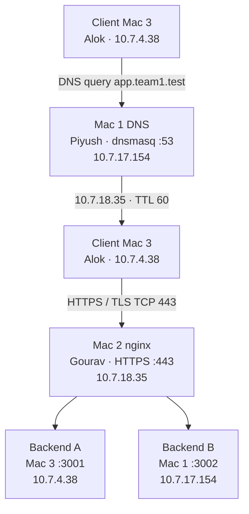

# Architecture

Team 1 runs a private service on three physical Macs. All three use Wi-Fi interface `en0` on network `10.7.0.0/19`. The gateway is `10.7.0.1`. The subnet mask is `255.255.224.0`.

Mac 1 answers private DNS and also runs Backend B. Mac 2 is the HTTPS edge. Mac 3 runs Backend A, issues the test commands, and captures packets.

Diagrams drawn from these addresses:

- [network-architecture.png](network-architecture.png)
- [diagrams/topology.svg](diagrams/topology.svg) and [diagrams/topology.png](diagrams/topology.png)
- [diagrams/request-flow.svg](diagrams/request-flow.svg) and [diagrams/request-flow.png](diagrams/request-flow.png)
- [Architecture-Document.pdf](Architecture-Document.pdf)

## Machine details

| | Mac 1 | Mac 2 | Mac 3 |
| --- | --- | --- | --- |
| Person | Piyush | Gourav | Alok |
| Role | Private DNS and Backend B | Edge, nginx, TLS, load balancer | Backend A, test client, Wireshark |
| IP address | 10.7.17.154 | 10.7.18.35 | 10.7.4.38 |
| Subnet mask | 255.255.224.0 | 255.255.224.0 | 255.255.224.0 |
| Gateway | 10.7.0.1 | 10.7.0.1 | 10.7.0.1 |
| Interface | en0 | en0 | en0 |
| MAC address | 10:9f:41:c0:9e:e5 | e6:09:91:27:22:3b | 72:36:67:c5:54:98 |
| Service ports | 53, 3002 | 443 | 3001 |

`/19` covers `10.7.0.0` through `10.7.31.255`. Every address in the table is inside that range, so the Macs reach each other without leaving the LAN.

## Topology

## DNS flow

1. The client resolver on Mac 3 is `10.7.17.154`.
2. Mac 3 sends a DNS query for `app.team1.test` to Mac 1 port 53.
3. dnsmasq matches `address=/app.team1.test/10.7.18.35` and returns an A record with TTL 60.
4. `api.team1.test` is a second name for the same edge address.
5. Names that are not in the address list are forwarded to `8.8.8.8` and `1.1.1.1` because `no-resolv` ignores the host's own resolv.conf.

`domain-needed` drops names that have no dots. `bogus-priv` blocks reverse lookups for private ranges from being forwarded upstream.

## HTTPS and TLS flow

1. After the A record is cached, Mac 3 connects to `10.7.18.35` TCP port 443.
2. The TCP handshake completes: SYN from `10.7.4.38`, SYN-ACK from `10.7.18.35`, ACK from `10.7.4.38`.
3. The TLS ClientHello carries SNI `app.team1.test`.
4. nginx selects the certificate whose SAN list contains that name.
5. The client checks the chain against Team1 Local CA, which is trusted on all three Macs.
6. nginx allows TLS 1.2 and TLS 1.3. A normal connection uses TLS 1.3. A forced TLS 1.2 handshake leaves the Certificate message visible, with issuer `Team1 Local CA` and subject `app.team1.test`.

## Reverse proxy flow

nginx accepts the decrypted HTTP request and opens an HTTP connection to the upstream group named `backends`. It sets:

- `Host` from the original request
- `X-Real-IP` from the client address
- `X-Forwarded-For` with the forwarded client chain

The upstream response, including `X-Backend`, is returned on the client's HTTPS connection. The backend exchange itself is HTTP on the LAN.

## Backend flow

| Request | Backend A `10.7.4.38:3001` | Backend B `10.7.17.154:3002` |
| --- | --- | --- |
| `GET /` | JSON greeting, `X-Backend: A` | JSON greeting, `X-Backend: B` |
| `GET /api/status` | `status: ok` and identity A | `status: ok` and identity B |
| `GET /api/cached` | `Cache-Control: max-age=60`, stable `ETag` | Same body and `ETag`, header `X-Backend: B` |

The upstream uses round-robin. The counted lab series of eight requests returned `X-Backend` in this order: B, A, B, A, B, A, B, A.

If Backend A refuses connections, `max_fails=1` and `proxy_next_upstream` send the request to Backend B. If both refuse, nginx still completes TLS and returns `502 Bad Gateway`.
