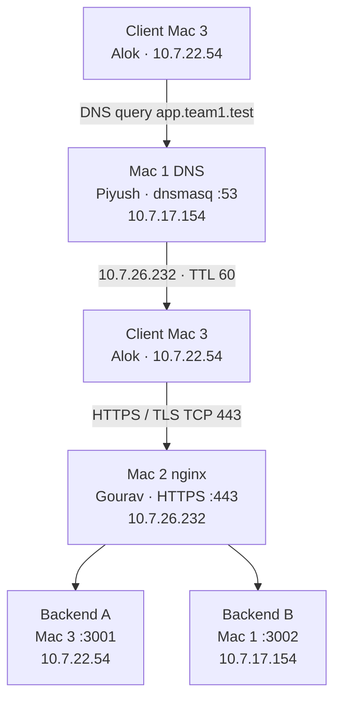

# Team 1 — Private DNS, HTTPS/TLS, Reverse Proxy, Load Balancing, HTTP Caching and Packet Analysis

## Overview

Team 1 built a private web service across three physical Macs on one Wi-Fi LAN. A private DNS server publishes two hostnames. An edge Mac terminates HTTPS, speaks HTTP/2, and reverse-proxies requests to two backends with round-robin load balancing and failover. The backends support HTTP caching with `Cache-Control` and `ETag` validation. Packet captures on the client Mac show DNS, the TCP handshake, and TLS.

This repository holds the architecture notes, the configuration that was used, the backend program, and the lab evidence that was retained. The index is [04-Evidence/EVIDENCE-INDEX.md](04-Evidence/EVIDENCE-INDEX.md). A file is marked available only when it is in the tree. Tests whose original screenshots were not kept are marked not retained. The written report in `docs/` is not packet evidence.

## Team members and roles

| Person | Machine | Combined roles |
| --- | --- | --- |
| Piyush | Mac 1 | Private DNS server and Backend B |
| Gourav | Mac 2 | Edge server, nginx reverse proxy, round-robin load balancer, TLS/HTTPS termination |
| Alok | Mac 3 | Backend A, test client, Wireshark packet capture |

## Submission type

**Type 2 — 2 or 3 Macs with combined roles.**

Three physical Macs share the work. Mac 1 runs DNS and Backend B. Mac 3 runs Backend A, the test client, and Wireshark. Mac 2 is only the edge.

## Architecture



The client never opens HTTP directly to ports 3001 or 3002 for the public names. Those ports are the upstream targets used by nginx on the LAN.

Full addressing, interface, and MAC details are in [01-Architecture-Document/README.md](01-Architecture-Document/README.md).

## Machine and IP table

Network: `10.7.0.0/19`  
Gateway: `10.7.0.1`  
Subnet mask on every Mac: `255.255.224.0`  
Interface on every Mac: `en0`

| Machine | Person | IP address | MAC address | Services |
| --- | --- | --- | --- | --- |
| Mac 1 | Piyush | 10.7.17.154 | 10:9f:41:c0:9e:e5 | dnsmasq UDP/TCP 53, Backend B TCP 3002 |
| Mac 2 | Gourav | 10.7.26.232 | e6:09:91:27:22:3b | nginx HTTPS 443, TLS 1.2 and TLS 1.3, HTTP/2 |
| Mac 3 | Alok | 10.7.22.54 | 72:36:67:c5:54:98 | Backend A TCP 3001, curl/dig, Wireshark on en0 |

## Request flow

1. Mac 3 asks Mac 1 (`10.7.17.154`) for `app.team1.test`.
2. dnsmasq answers with `10.7.26.232` and a TTL of 60 seconds. `api.team1.test` uses the same address.
3. Mac 3 opens TCP port 443 on Mac 2. The handshake is SYN, SYN-ACK, ACK.
4. Mac 2 presents the server certificate for `app.team1.test`, issued by Team1 Local CA. The certificate also lists `api.team1.test` as a subject alternative name.
5. nginx terminates TLS and proxies the request over plain HTTP to Backend A (`10.7.22.54:3001`) or Backend B (`10.7.17.154:3002`).
6. The chosen backend sets `X-Backend: A` or `X-Backend: B`. nginx returns that response on the existing HTTPS connection.

## DNS architecture

Mac 1 is the only resolver that knows the team names. The client Macs use `10.7.17.154` as their DNS server.

| Name | Type | Address | TTL |
| --- | --- | --- | --- |
| app.team1.test | A | 10.7.26.232 | 60 |
| api.team1.test | A | 10.7.26.232 | 60 |

dnsmasq is configured with `domain-needed`, `bogus-priv`, and `no-resolv`. Unknown names are forwarded to `8.8.8.8` and `1.1.1.1`. Queries are logged to `/tmp/dnsmasq.log`. The file is [02-Configuration-Bundle/dns/dnsmasq.conf](02-Configuration-Bundle/dns/dnsmasq.conf).

A resolver that does not have these records, such as `8.8.8.8`, returns NXDOMAIN for `app.team1.test`.

## Backend architecture

Both backends run [03-Source-Code/backend/server.py](03-Source-Code/backend/server.py).

| Backend | Host | Listen address |
| --- | --- | --- |
| A | Mac 3 (Alok) | 10.7.22.54:3001 |
| B | Mac 1 (Piyush) | 10.7.17.154:3002 |

| Method and path | Behavior |
| --- | --- |
| `GET /` | Short JSON greeting that names the backend |
| `GET /api/status` | JSON identity and status, plus `X-Backend: A` or `X-Backend: B` |
| `GET /api/cached` | JSON body with `Cache-Control: max-age=60` and an `ETag` |

The cached document is the same on A and B, so the `ETag` does not change when the load balancer switches backends. `X-Backend` still identifies which process answered.

## nginx reverse proxy

Mac 2 runs nginx 1.31.6. The site file copied from `/opt/homebrew/etc/nginx/servers/team1.conf` is [02-Configuration-Bundle/edge/nginx-servers-team1.conf](02-Configuration-Bundle/edge/nginx-servers-team1.conf).

- `listen 443 ssl` and `http2 on`
- `server_name app.team1.test api.team1.test`
- TLS certificate and private key paths point at the files on Mac 2
- `ssl_protocols TLSv1.2 TLSv1.3`
- `proxy_pass http://backends` for `/`
- `Host`, `X-Real-IP`, and `X-Forwarded-For` are forwarded
- `proxy_connect_timeout 2s` and `proxy_next_upstream error timeout http_502`

nginx decrypts the client request and opens a new HTTP connection to the selected backend. Clients do not see ports 3001 and 3002.

## Round-robin load balancing

The upstream block lists Backend A first and Backend B second, with no explicit weights, so nginx uses its default round-robin policy:

```
10.7.22.54:3001
10.7.17.154:3002
```

Each upstream has `max_fails=1` and `fail_timeout=10s`. If a backend does not accept a connection, nginx marks it unavailable and sends the request to the other one.

The final verified series was six consecutive HTTPS requests. `X-Backend` came back A, B, A, B, A, B. No screenshot of that series was saved. The nginx file is the retained record of the two-backend pool.

## TLS and HTTPS

Team1 Local CA is a local root created on Mac 2. It signed a server certificate whose subject is `app.team1.test` and whose subject alternative names are:

- `DNS:app.team1.test`
- `DNS:api.team1.test`

The CA certificate was added to the System keychain on all three Macs, so `curl` verifies the chain without `-k`. Public certificates are in [03-Source-Code/edge/ca-public](03-Source-Code/edge/ca-public). The setup steps are in [02-Configuration-Bundle/edge/TLS-SETUP.md](02-Configuration-Bundle/edge/TLS-SETUP.md).

`teamCA.key` and `app.key` stay on Mac 2. They are not part of this repository.

## HTTP/2

nginx advertises HTTP/2 on port 443 (`http2 on`). Successful HTTPS requests to `https://app.team1.test/api/status` were completed with HTTP/2.

## HTTP caching

`GET /api/cached` returns:

- `Cache-Control: max-age=60`
- an `ETag` for the cached JSON document

A follow-up request that sends that value in `If-None-Match` receives `304 Not Modified` and an empty body.

The final live response from `https://app.team1.test/api/cached` was HTTP/2 200 from nginx 1.31.6, `content-type: application/json`, `content-length: 51`, `x-backend: B`, `cache-control: max-age=60`, and `etag: "a8975e0e7afcd001cfc2938f7a0feecb"`. That header transcript was not saved as a file. This observed ETag is the live result. The checked-in `server.py` also sends `Cache-Control: max-age=60` and an ETag, and it returns 304 when `If-None-Match` matches, but its cached document is a different body, so its ETag is not that live value.

An older access log, from 4 Oct 2026, records `GET /api/cached HTTP/2.0` status `200` at 01:58:33 and status `304` at 01:59:10. The client address in that log is the capture-time address `10.7.4.38`. The log does not store `Cache-Control` or `ETag`. The file is [04-Evidence/F-HTTP-Caching/mac2_nginx_access.log](04-Evidence/F-HTTP-Caching/mac2_nginx_access.log).

## Wireshark packet analysis

The final live test on Mac 3 (`en0`) showed:

1. DNS query `10.7.22.54` to `10.7.17.154` UDP/53 for `app.team1.test` A.
2. Response `10.7.26.232`, TTL 60.
3. TCP handshake `10.7.22.54:58709` to `10.7.26.232:443`: SYN, SYN-ACK, ACK.
4. ClientHello with SNI `app.team1.test`, TLS 1.3 negotiated.
5. Later HTTP was encrypted TLS Application Data.

No packet file of that test was saved.

The file `phase1_full_flow.pcapng` and the screenshots in [04-Evidence/G-Packet-Capture](04-Evidence/G-Packet-Capture) are historical. Their DHCP addresses are capture-time values: client `10.7.4.38`, edge `10.7.18.35`, DNS `10.7.17.154`. That capture shows the same stages — DNS answer, TCP handshake, ClientHello SNI, a TLS 1.2 certificate from Team1 Local CA, and encrypted Application Data. TLS 1.3 encrypts the Certificate message, so the issuer and subject were read from the TLS 1.2 handshake in that older capture.

## Failure scenarios

`dig @8.8.8.8 app.team1.test` returned NXDOMAIN in the final test. No screenshot was saved.

An earlier wrong-record test temporarily answered `10.7.31.250` and the HTTPS connection timed out. The record was restored. The checked-in `dnsmasq.conf` answers `10.7.26.232`. No screenshot of that test was saved.

An earlier wrong-port test to `https://app.team1.test:4443` resolved and then returned `Connection refused`. No screenshot was saved. The historical notes of that test used the capture-time edge address `10.7.18.35`.

Older nginx logs in [04-Evidence/H-Failure-Scenarios](04-Evidence/H-Failure-Scenarios) are historical. At 01:52:30 they show a refused connection to capture-time Backend A `10.7.4.38:3001` while the access log recorded HTTP/2.0 `200`. Around 01:56 both `10.7.4.38:3001` and `10.7.17.154:3002` refused connections and the access log recorded HTTP/2.0 `502`. Those logs do not contain `X-Backend`.

## Failure Demonstration — Backend A Failover

Before failure, six requests returned `x-backend` A, B, A, B, A, B.

Backend A on Mac 3 (`10.7.22.54:3001`) was stopped. During the failure, six requests returned `x-backend` B, B, B, B, B, B. nginx kept serving through the healthy backend.

Backend A was restarted. The next six requests returned B, B, A, B, A, B. Both backends were available again.

No screenshot of this demonstration was saved.

## Test results

Final live checks. A screenshot or capture was not saved for this session unless the evidence column names a file.

| # | Test | Result | Evidence in this repo |
| --- | --- | --- | --- |
| 1 | DNS resolution | `app.team1.test` resolved to `10.7.26.232` from server `10.7.17.154`, TTL 60 | Final transcript not saved. Historical pcap and G2 show the same name resolving to capture-time `10.7.18.35` |
| 2 | Public DNS isolation | `dig @8.8.8.8 app.team1.test` returned NXDOMAIN | Not retained |
| 3 | HTTPS/TLS | Verification succeeded without `-k`. SAN `app.team1.test`. Issuer Team1 Local CA. TLS 1.3. HTTP/2 200 | Final transcript not saved. Historical E1 shows verification, HTTP/2 200, and `x-backend: B` |
| 4 | Load balancing | Six requests returned `X-Backend` A, B, A, B, A, B | Configuration file only. The series was not saved |
| 5 | Backend A failover | While `10.7.22.54:3001` was stopped, six requests returned B. After restart the series was B, B, A, B, A, B | Not retained. Historical nginx logs show an earlier failover without `X-Backend` |
| 6 | HTTP caching | HTTP/2 200, `cache-control: max-age=60`, `etag: "a8975e0e7afcd001cfc2938f7a0feecb"`, `x-backend: B` | Header text not saved. Historical access log shows a `304` on `/api/cached` |
| 7 | Both backends down | Historical nginx log recorded HTTP/2.0 `502` | Available in the 4 Oct logs. Not repeated as a new file |
| 8 | Wrong port 4443 | Earlier test: name resolved, then connection refused | Not retained |

## Repository structure

```
.
├── README.md
├── .gitignore
├── 01-Architecture-Document/
│   ├── README.md
│   ├── Architecture-Document.pdf
│   ├── network-architecture.png
│   └── diagrams/
│       ├── topology.svg
│       ├── topology.png
│       ├── request-flow.svg
│       └── request-flow.png
├── 02-Configuration-Bundle/
│   ├── README.md
│   ├── team.env
│   ├── backend/BACKEND-LAUNCH.md
│   ├── dns/dnsmasq.conf
│   ├── dns/etc-resolver-team1.test
│   └── edge/
│       ├── TLS-SETUP.md
│       ├── nginx-servers-team1.conf
│       └── team1-root-ca.crt
├── 03-Source-Code/
│   ├── README.md
│   ├── team.env
│   ├── lib.sh
│   ├── backend/server.py
│   ├── common/
│   ├── dns/
│   └── edge/ca-public/
├── docs/
│   └── Team1_Computer_Networks_Project_Report.docx
└── 04-Evidence/
    ├── EVIDENCE-INDEX.md
    ├── A-LAN-Setup/
    ├── B-Private-DNS/
    ├── C-Backends/
    ├── D-Load-Balancing/
    ├── E-HTTPS-TLS/
    ├── F-HTTP-Caching/
    ├── G-Packet-Capture/
    ├── H-Failure-Scenarios/
    ├── I-Troubleshooting-Notes/
    └── _raw-extra/
```

Role guides and the demo checklist are in `03-Source-Code`. Evidence status is only in [04-Evidence/EVIDENCE-INDEX.md](04-Evidence/EVIDENCE-INDEX.md). The report under `docs/` explains the project in prose and is not a substitute for the capture or the logs.

## How to reproduce

Use three Macs on `10.7.0.0/19` with the addresses in the table above. Python 3 is enough for the backends. Mac 2 needs nginx and OpenSSL. Mac 1 needs dnsmasq. Mac 3 needs `dig`, `curl`, and Wireshark.

**Mac 1 — DNS and Backend B**

```bash
cd 03-Source-Code/dns
./setup-dns.sh /opt/homebrew/etc/dnsmasq.conf
sudo dnsmasq -C /opt/homebrew/etc/dnsmasq.conf

cd ../backend
./start-backend.sh B
```

**Mac 3 — Backend A and the client**

```bash
cd 03-Source-Code/backend
./start-backend.sh A

cd ../common
./use-team-dns.sh
```

**Mac 2 — TLS edge**

Keep `app.key` beside `app.crt` on the edge Mac only. The checked-in nginx file expects:

- certificate: `/Users/gouravtanwar/cn-certs/app.crt`
- private key: `/Users/gouravtanwar/cn-certs/app.key`

Trust the CA on each Mac, then start nginx:

```bash
sudo security add-trusted-cert -d -r trustRoot \
  -k /Library/Keychains/System.keychain \
  /path/to/teamCA.crt

nginx -t
brew services start nginx
```

Point a browser or `curl` at `https://app.team1.test/api/status` from Mac 3. Do not pass `-k`.

## Useful commands

```bash
dig app.team1.test
dig @10.7.17.154 app.team1.test

curl -v https://app.team1.test/api/status

for i in {1..6}; do
  curl -s -D - -o /dev/null https://app.team1.test/api/status | grep -i x-backend
done

curl -s -D - -o /dev/null https://app.team1.test/api/cached | grep -iE 'HTTP/|cache-control|etag'
ETAG=$(curl -s -D - -o /dev/null https://app.team1.test/api/cached | awk -F': ' 'tolower($1)=="etag"{print $2}' | tr -d '\r')
curl -s -D - -o /dev/null -H "If-None-Match: $ETAG" https://app.team1.test/api/cached

curl -v https://app.team1.test:4443
openssl x509 -in 03-Source-Code/edge/ca-public/app.crt -noout -subject -issuer -ext subjectAltName
```

Direct backend checks, bypassing the proxy:

```bash
curl -i http://10.7.22.54:3001/api/status
curl -i http://10.7.17.154:3002/api/status
```

## Security notes

- `*.key`, `teamCA.key`, and `app.key` are listed in [.gitignore](.gitignore).
- The private keys were created on Mac 2 and were not copied into this repository.
- Public files `teamCA.crt`, `app.crt`, `app.csr`, and `app.ext` are included so the certificate chain and SAN list can be inspected.
- nginx references `app.key` by absolute path. That line is a filesystem path, not the key.
- The lab CA is a private root for `*.team1.test` on this LAN. It is not a public certificate authority.
- dnsmasq query logs on Mac 1 go to `/tmp/dnsmasq.log` and are not committed.

## Key learnings

- Name lookup, TCP connection setup, TLS, and the HTTP application are separate stages. A correct DNS answer does not mean the host is listening, and a listening host does not mean the requested port is open.
- A private zone is invisible to public resolvers. `8.8.8.8` returned NXDOMAIN for a name that Mac 1 answers locally.
- The reverse proxy gives clients one hostname and one port. Backend addresses stay on the LAN, and nginx can hide a dead upstream.
- Round-robin spreads requests. `max_fails` and `proxy_next_upstream` keep the site up when one backend stops. When both stop, TLS to nginx still succeeds and the client receives 502.
- Trust comes from the CA installed on the client, not from disabling verification. SAN entries are what allow one certificate to cover `app.team1.test` and `api.team1.test`.
- TLS 1.3 hides the Certificate message. A TLS 1.2 handshake was used to show the issuer and subject on the wire. After the handshake, Application Data is encrypted between the client and the edge.
- `Cache-Control: max-age=60` tells the client how long the response stays fresh. `ETag` plus `If-None-Match` lets the server answer `304 Not Modified` when the body has not changed.
