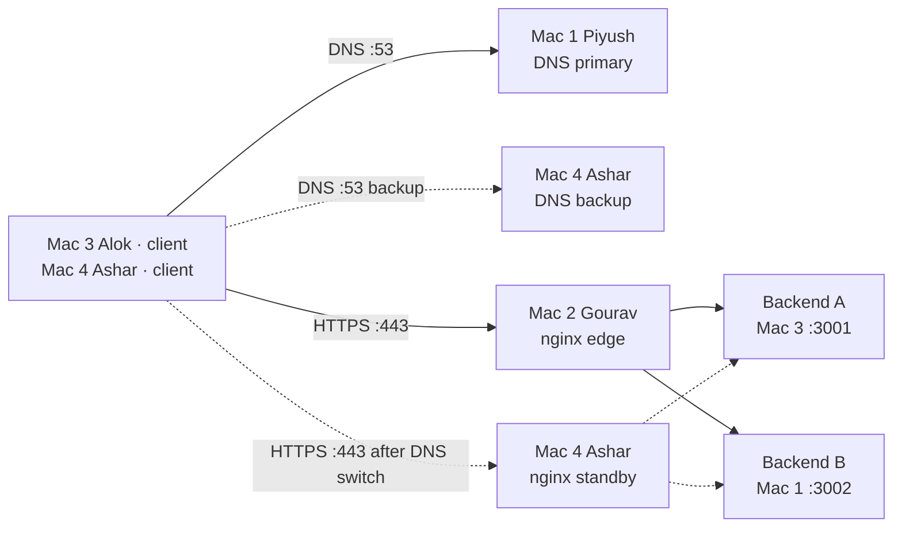

# Team 1 — Work Log and Responsibilities

Who did what, on which Mac, in Phase 1 and Phase 2, plus the script each person runs. Ashar Shaikh joined the team for Phase 2.

Status keys used below:

- ✅ **Done, verified** — the output was checked during the session.
- 🟡 **Done, proof pending** — the step was run, but the confirming output or screenshot still has to be taken.
- ⏳ **To do** — not run yet.

---

## 1. Team and machines

Addresses from the Phase 2 session on 25–26 Nov 2026. Wi-Fi hands out new addresses, so check them at the start of each lab day and update [`03-Source-Code/team.env`](03-Source-Code/team.env).

| Mac | Person | IP (26 Nov) | Phase 1 role | Phase 2 role | Script |
| --- | --- | --- | --- | --- | --- |
| Mac 1 | **Piyush** | 10.7.11.104 | Private DNS server (dnsmasq), Backend B :3002 | DNS TTL change, DNS switch, firewall on :3002 | [`piyush-mac1.sh`](03-Source-Code/team/piyush-mac1.sh) |
| Mac 2 | **Gourav** | 10.7.1.118 | Edge: nginx, HTTPS/TLS, HTTP/2, round-robin load balancer, certificates | Failover demo, single-point-of-failure explanation, certificate owner | [`gourav-mac2.sh`](03-Source-Code/team/gourav-mac2.sh) |
| Mac 3 | **Alok** | 10.7.15.147 | Backend A :3001, test client, Wireshark | Firewall on :3001, all client-side demos, fault checklist | [`alok-mac3.sh`](03-Source-Code/team/alok-mac3.sh) |
| Mac 4 | **Ashar Shaikh** (new) | 10.7.31.120 | — | Backup DNS server, standby edge nginx, second client, Phase 2 report | [`ashar-mac4.sh`](03-Source-Code/team/ashar-mac4.sh) |

Network `10.7.0.0/19`, gateway `10.7.0.1`, mask `255.255.224.0`, interface `en0` on every Mac.



---

## 2. Who did what

### Phase 1 — Build and Observe (Tasks A–G)

| Task | What | Piyush (Mac 1) | Gourav (Mac 2) | Alok (Mac 3) | Status |
| --- | --- | --- | --- | --- | --- |
| A | Private LAN, IP table, ping | Own Mac | Own Mac | Own Mac | ✅ |
| B | Private DNS `app/api.team1.test` | **Ran dnsmasq** | — | Client uses Mac 1 | ✅ |
| C | Two REST backends with `X-Backend` | **Backend B** | Checked both directly | **Backend A** | ✅ |
| D | nginx reverse proxy + round-robin | — | **Configured** | Tested A,B,A,B | ✅ |
| E | HTTPS with a local CA, no `-k` | Trusted CA | **Created CA + certificate** | Trusted CA, verified | ✅ |
| F | `Cache-Control`, `ETag`, `304` | — | — | **Tested** | ✅ (re-test on 26 Nov ⏳) |
| G | Packet capture DNS → TCP → TLS → HTTP | — | — | **Captured, analysed** | ✅ |
| 1F | Five failure tests | Changes the DNS record (wrong IP) | Edge logs show failover and 502 | Runs the client side of all five | ✅ |

### Re-setup on 25–26 Nov 2026 (start of Phase 2)

Every Mac had a new IP address, so Phase 1 was rebuilt before Phase 2.

| Person | What they did | Status |
| --- | --- | --- |
| **Everyone** | Found the new IPs, checked all four were on `10.7.0.0/19` | ✅ |
| **Piyush** | Rewrote `dnsmasq.conf` so `app.team1.test` → `10.7.1.118`, restarted dnsmasq (an old process was still running the old record) | ✅ `dig` from Mac 3 returned `10.7.1.118` |
| **Piyush** | Restarted Backend B (old process was holding port 3002) | ✅ |
| **Alok** | Restarted Backend A (old process was holding port 3001) | ✅ |
| **Alok** | Pointed Mac 3's DNS at Mac 1 | ✅ |
| **Gourav** | Created a **new** Team1 Local CA and server certificate (valid from 25 Nov 2026 19:18 GMT) | ✅ `openssl verify` → `app.crt: OK` |
| **Gourav** | Rewrote the nginx site with the new backend IPs, restarted nginx fully | ✅ both backends answered from Mac 2 |
| **Gourav** | Sent `teamCA.crt` to the team; sent `app.crt` + `app.key` to Mac 4 by `scp` | ✅ |
| **Alok** | Trusted the new CA (after replacing an older `teamCA.crt`, see troubleshooting) | ✅ `SSL certificate verify ok`, TLS 1.3, `HTTP/2 200`, `x-backend: A`, `x-edge: mac2` |
| **Alok** | Captured a new DNS + TCP + TLS 1.3 + TLS 1.2 flow to `team1-flow.pcap` (199 KB) | 🟡 Wireshark screenshots still to take |
| **Ashar** | Installed tools, trusted the CA, received the certificate, started standby nginx | ✅ `nginx -t` successful |

### Phase 2 — Harden and Recover (Extensions A–F)

| Ext | What | Owner | Helpers | Commands | Status |
| --- | --- | --- | --- | --- | --- |
| A | Backup DNS on Mac 4; stop Mac 1's DNS, names still resolve | **Ashar** | Piyush stops/starts DNS, Alok checks | `ashar dns-setup` → `ashar use-dns both`, `alok use-dns both` → `piyush dns-stop` → `alok dns-check` → `piyush dns-start` | ⏳ |
| B | TTL 30 s, change a record, watch the cached answer, flush | **Piyush** | Ashar (same change on Mac 4), Alok watches | `piyush ttl 30` + `ashar ttl 30` → `alok watch` → `piyush record standby` + `ashar record standby` | ⏳ |
| C | Only the edges may reach ports 3001/3002 | **Piyush** (3002) + **Alok** (3001) | Gourav tests from the edge | `piyush firewall-on`, `alok firewall-on` → `gourav backends` → `alok isolation-test` → both `firewall-off` | ⏳ |
| D | Stop Backend A, all traffic to B, restart, A returns; name the SPOF | **Gourav** | Alok stops A and runs the test | `alok lb` → Ctrl+C Backend A → `alok lb` → `alok backend` → `alok lb`; `gourav failover-notes` | ⏳ |
| E | Standby nginx on Mac 4, DNS switch to it | **Ashar** | Gourav sent the certificate, Piyush switches DNS, Alok watches | `ashar nginx-setup` → `alok test-standby` → run together with B | 🟡 nginx running, `x-edge: mac4` test pending |
| F | Evaluator injects a fault; diagnose layer by layer | **Everyone** | — | `alok diagnose` | ⏳ (on demo day) |
| — | Phase 2 report | **Ashar** collects | Each owner writes their extension's paragraph | — | ⏳ |

In the commands column, `alok lb` means run `./alok-mac3.sh lb` inside `03-Source-Code/team/` on that person's Mac.

---

## 3. Scripts — one per person

All four scripts live in [`03-Source-Code/team/`](03-Source-Code/team) and read the IP addresses from [`team.env`](03-Source-Code/team.env). Run a script with no command to see its menu.

```bash
cd ~/Computer_Networks/03-Source-Code/team
./alok-mac3.sh            # shows Alok's command list
./alok-mac3.sh lb         # runs one command
```

Every run is also saved as a text file in `04-Evidence/_runs/<date>/`, so terminal output can be used as evidence. `backend` and `share-ca` are not saved because they keep running.

### Piyush — `piyush-mac1.sh`

| Command | What it does |
| --- | --- |
| `info`, `ping` | This Mac's IP/MAC/gateway; ping all four Macs |
| `dns-setup` | Writes `dnsmasq.conf` (`app.team1.test` → Mac 2) and starts DNS |
| `dns-test` | Asks this DNS server for `app.team1.test` |
| `backend` | Starts Backend B on port 3002 (stops an old one first) |
| `local-resolver` | Lets Mac 1 itself open `https://app.team1.test` |
| `trust-ca [file]` | Trusts Gourav's CA and removes older copies |
| `record wrong` / `record edge` | Failure test 1F.2 and undo |
| `dns-stop` / `dns-start` | Extension A demo |
| `ttl 30` | Extension B |
| `record standby` / `record edge` | Extension B + E switch to Mac 4 and back |
| `firewall-on` / `firewall-off` | Extension C for port 3002 |

### Gourav — `gourav-mac2.sh`

| Command | What it does |
| --- | --- |
| `info`, `ping` | This Mac's IP/MAC/gateway; ping all four Macs |
| `backends` | Checks Backend A and B directly |
| `nginx-setup` | Writes the nginx site with today's backend IPs, restarts, tests |
| `nginx-restart` | Full stop + start (needed after a certificate change) |
| `test`, `errors` | HTTPS test against this edge; last 20 error-log lines |
| `certs` | Shows certificate, CA fingerprint, and verifies the pair |
| `share-ca` | Serves **only** `teamCA.crt` on port 8000 for the others to download |
| `send-certs [user]` | Copies `app.crt` + `app.key` to Mac 4 |
| `trust-ca` | Trusts the CA on Mac 2 |
| `failover-notes` | What to say for Extension D and the single point of failure |

### Alok — `alok-mac3.sh`

| Command | What it does |
| --- | --- |
| `info`, `ping` | This Mac's IP/MAC/gateway; ping all four Macs |
| `backend` | Starts Backend A on port 3001 (stops an old one first) |
| `use-dns team\|both\|google\|auto` | Sets Mac 3's DNS servers |
| `trust-ca [file]` | Trusts Gourav's CA and removes older copies |
| `dns-check`, `https`, `lb [n]`, `cache` | Demo steps 3, 4, 5 and 7 |
| `capture`, `analyze [file]` | Records one request and prints DNS / handshake / SNI / certificate / encrypted data |
| `fail-dns`, `fail-port`, `status-code` | Failure tests 1F.1, 1F.5, and the 502 check for 1F.4 |
| `firewall-on` / `firewall-off`, `isolation-test` | Extension C |
| `test-standby` | Extension E: HTTPS straight to Mac 4 |
| `watch [seconds]` | Extension B + E: resolved IP, `X-Edge`, `X-Backend` every 2 s |
| `diagnose` | Extension F: DNS → IP → TCP → TLS → HTTP → backends |

### Ashar — `ashar-mac4.sh`

| Command | What it does |
| --- | --- |
| `info`, `ping` | This Mac's IP/MAC/gateway; ping all four Macs |
| `trust-ca [file]`, `use-dns both`, `https` | Second client setup and test |
| `dns-setup`, `dns-test`, `dns-start`, `dns-stop` | Extension A backup DNS |
| `receive-certs` | Prepares Mac 4 for Gourav's `send-certs` |
| `nginx-setup`, `nginx-restart`, `test` | Extension E standby edge |
| `ttl 30`, `record standby`, `record edge` | Extension B + E on the backup DNS server |
| `cleanup` | Deletes the copied private key after the project |

---

## 4. Order of work for the rest of Phase 2

Each line names who runs what. Wait for the ✅ before the next line.

1. **Everyone:** `info` — check today's IP. If it changed, update `team.env` and tell the others.
2. **Everyone:** `ping` — all four reply.
3. **Piyush:** `dns-setup`, then `backend` in a second window. **Alok:** `backend`. **Gourav:** `nginx-setup`. **Ashar:** `dns-setup`, `nginx-setup`.
4. **Alok and Ashar:** `use-dns both`.
5. **Alok:** `https`, `lb`, `cache`, `test-standby` — Phase 1 healthy, both edges answer. 📸
6. **Extension A:** Piyush `dns-stop` → Alok `dns-check` (answer from `10.7.31.120`) → Piyush `dns-start`. 📸
7. **Extension C:** Piyush and Alok `firewall-on` → Gourav `backends` (works) → Alok `isolation-test` (blocked, site works) → Piyush and Alok `firewall-off`. 📸
8. **Extension D:** Alok `lb` → Alok stops Backend A (Ctrl+C) → `lb` (all B) → `backend` → `lb` (A returns). Gourav explains with `failover-notes`. 📸
9. **Extension B + E:** Piyush and Ashar `ttl 30` → Alok `watch 90` → Piyush and Ashar `record standby` → watch the IP and `x-edge` change after ≤ 30 s → second round with a flush → Piyush and Ashar `record edge`. 📸
10. **Extension F rehearsal:** one person breaks something (stop nginx, stop dnsmasq, wrong record), Alok runs `diagnose`, the team names the layer.
11. **Ashar:** collect the Phase 2 report paragraphs.

The same steps with copy buttons are on the team runbook page.

---

## 5. Notes

- **Certificates changed on 25 Nov 2026.** The CA and server certificate in `02-Configuration-Bundle/edge/` and `03-Source-Code/edge/ca-public/` are the Phase 1 ones (valid from 3 Oct 2026). The live ones on Mac 2 are valid from 25 Nov 2026 19:18 GMT, CA fingerprint `C6:54:AD:FD:…:94:B7:B3:3B`. Copy the new public files (`teamCA.crt`, `app.crt`, `app.csr`, `app.ext`) into the repository before submission. Never commit `teamCA.key` or `app.key`.
- **Mac 4 holds a copy of `app.key`** for the standby edge. Run `./ashar-mac4.sh cleanup` after the project.
- **Copy commands from the scripts or the runbook, not from WhatsApp.** WhatsApp treats `~` as strikethrough and deletes it.
- Problems met on 25–26 Nov and how each was fixed: [04-Evidence/I-Troubleshooting-Notes](04-Evidence/I-Troubleshooting-Notes/README.md).
